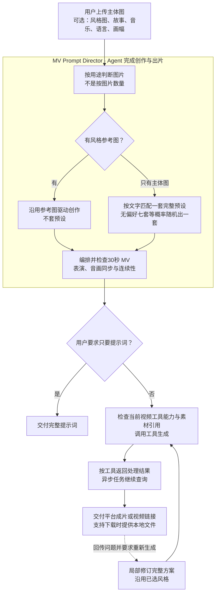

# MV Prompt Director · 使用指南

交付版本：v2.1 · 整理日期：2026-11-12

上传主体图，也可以继续上传风格参考图并附一句创意，Agent 会完成创作，通过当前可用的视频生成工具生成音乐 MV。默认使用 Seedance 2.5，目标为30秒、16:9横幅、1080p、有声。完成后交付平台成片或可访问的视频链接；工具支持下载时再提供本地文件。说“只要提示词”时，仍可使用原来的提示词交付方式。

## 文件内容

以下路径均相对于 `mv-prompt-director` 文件夹：

- [SKILL.md](SKILL.md)：核心创作规则与检查流程。
- [references/prompt-templates.md](references/prompt-templates.md)：完整 MV、单场景与修订输出模板。
- [references/subject-only-presets.md](references/subject-only-presets.md)：七套模板的选择规则，以及附赠 PDF 第5–8页的四套原始视觉模板与 MV 编排补充。
- [references/video-inspired-presets.md](references/video-inspired-presets.md)：三套视频参考模板，包含视觉母版、音乐表演、30 秒编排与可替换项。
- [scripts/select_preset.py](scripts/select_preset.py)：从七套或指定候选集合中等概率随机抽取一套预设。
- [references/video-generation.md](references/video-generation.md)：当前视频工具的能力检查、素材引用、生成与结果处理。
- [agents/openai.yaml](agents/openai.yaml)：供支持该格式的工具读取的展示与调用信息。
- 本使用指南：安装、创作、反馈与[使用授权](#使用授权)说明。

请保留整个 `mv-prompt-director` 文件夹及内部目录结构，包括本指南中的授权说明。

## 安装与加载

### 支持 Skill 的 Agent

使用所选 Agent 提供的本地 Skill 导入或安装方式，加载整个 `mv-prompt-director` 文件夹。根据该工具提示刷新或新开会话，确认 Skill 已可用。安装位置、导入格式和调用语法以所用 Agent 为准；本包不包含安装程序。

### 可读取文件的其他 Agent

将整个文件夹放入 Agent 可访问的工作区，上传图片后发送：

> 请读取 mv-prompt-director/SKILL.md，根据我上传的图片创作30秒、16:9横幅音乐 MV，并通过当前可用的视频生成工具使用 Seedance 2.5 生成视频。其余创作设定请合理补全，完成后交付成片；工具支持下载时再提供本地文件。

如果 Agent 没有可用的视频生成工具，可以使用“仅提示词”模式。提供核心 Skill 与配套参考文件，保留文件名并说明引用关系；有风格参考图时按图创作，不套预设。

直接出片需要 Agent 能查看参考图片、读取 Skill 文件，并调用视频生成工具。Python 只用于可选的随机预设脚本；无法运行脚本时，可使用当前环境提供的随机工具。没有 Python 不影响视频工具本身的调用能力。实际跨 Agent 兼容性需在所用工具中确认。

## 视频工具准备

Agent 会检查当前视频工具的说明，核对模型、时长、画幅、分辨率、音频和参考素材的支持情况。素材标识、上传方式、授权要求和任务查询方式以实际工具说明及返回结果为准。

默认模型是 Seedance 2.5。没有可用视频工具，或工具不能满足明确要求时，Agent 会完成可做的创作工作并说明具体缺项，不会自行切换到外部接口、替换指定模型或缩短时长。只有实际工具要求补充素材或授权信息时，才按其要求处理。

## 图片怎么准备

- **主体图：** 希望出现在 MV 里的本人或角色照片。
- **风格参考图：** 希望采用的穿搭、场景、灯光、色彩或整体氛围。

建议先上传主体图，再上传风格图，并简单标注用途，例如：

> 图1是本人；图2参考穿搭；图3参考场景；图4参考灯光。

不必凑满四张。一张主体图加一张风格图就会按参考图驱动方式创作。风格图里出现其他人物时，只参考其造型或画面风格，不会用其身份替换主体。

一张或多张本人照片都属于“只有主体图”。Skill 按文字匹配七套中的一套；无偏好时等概率随机，每套为 1/7（约 14.29%）。不按照片外貌猜音乐喜好，不要求补风格图或先生成模板图片。

只有主体图时默认采用模板服装；说“保留原服装／不要换衣服”时锁定照片中可见的款式、颜色、材质、印花和饰件，未展示部分自然延续。有穿搭参考图时按指定来源换装，明确保留主体原服装的文字要求仍优先。

单人女团风按单人表演；清楚的多人合照泛指全体时，分别编排身份、服装与声部。只使用其中一人时直接指明。仅在图片用途或人物指代确实不清楚时追问。

## 可用模板

| 编号 | 模板 | 主要视觉与调用偏好 |
|---|---|---|
| P1 | 午夜红车 | 红色复古车、广角伸手、直接闪光 |
| P2 | 红蓝车厢 | 黑色车厢、红蓝双色光；Trap／Grime |
| P3 | 烟火巷道 | 混凝土巷道、烟火与悬浮高潮 |
| P4 | 工业夜行 | 工业场地、犬群、红色牵引线与冷白烟雾 |
| P5 | 糖果拼贴 | Y2K／Pop／K-pop／女团风；白边贴纸、网点、糖果色与镀铬画框 |
| P6 | 复古街头派对 | Old-school／Old fashion；日常院落、DJ 与闪光抓拍 |
| P7 | 电气双生 | Electro-punk／电气朋克；机械实验室与机车工坊平行剪辑 |

可以直接说“用糖果拼贴，保留原服装”或“用电气双生，只保留一个主唱”。“复古”会在 P1、P6 中随机选择；“Old school／Old fashion”明确匹配 P6。“韩国女团＋工业夜行”优先采用指定的工业场景，音乐仍按韩国女团风编排。

P1–P4 来自 PDF 原始模板，P5–P7 提取视频的场景、表演与剪辑关系。道具是可覆盖的默认载体，例如“不要汽车”“去掉机械臂”；一套模板可以包含多个关联场景。

## Skill 架构与使用路径

## 第一次使用

如果 Skill 已安装并在当前会话可用，上传图片后发送：

> 使用 $mv-prompt-director，根据这些图片生成30秒、16:9横幅音乐 MV，直接调用模型出视频。其余创作设定你来决定。

也可以附一句偏好，例如：

> 英文 K-pop，现实与梦境交错，前2秒高速闪切，人物表演自然，镜头有远中近变化。

不必准备分镜表或逐项填写参数。想逐步讨论时，补充“先和我讨论方案，暂不生成”；想只拿提示词时说“只要完整提示词，不调用模型”。

如果当前会话无法调用 `$mv-prompt-director`，使用[安装与加载](#安装与加载)中的文件读取方式。

## 生成与反馈

1. Agent 完成提示词与素材映射，检查当前工具支持的参数后提交本轮生成；正常情况下无需手动复制提示词到平台。
2. 工具返回异步任务时，Agent 保留任务标识并按该工具提供的方式继续查询。等待超时时可说“继续查询刚才的任务”，不会自动重复提交。
3. 完成后拿到平台成片或可访问的视频链接；工具支持下载时再提供本地文件。链接可能过期，有下载功能时可保存成片。本地输出存放在 Skill 目录外。
4. 查看人物、服装、镜头、音乐与同步。仅修改提示词可说“调整8–12秒演唱，先不要生成”；要新成片则说“修改后重新生成”，这会创建新任务并使用新的生成额度。

仅提示词模式会给完整可复制代码块，仍可按同序图片手动提交到生成平台。

## 创作与修订

- 用户指定的音乐、语言、服装、画幅和时长优先，也可要求无歌词、指定音轨或单场景。指定音轨需要提供实际音频素材；参数范围和音频输入方式以当前视频工具为准。工具不支持明确要求时，会说明缺项，不自动换模型或缩短。
- 每次新创作只选择一次模板，同一支 MV 不混搭；只改音乐、服装、歌词或画幅时沿用已选风格。
- 明确指定换套时直接切换；要求“重新随机”时才重抽，允许重复。要求换不同套时排除当前套，独立创作也允许连续抽中同一套。
- 图片编号与叙事顺序相互独立，场景不必按上传顺序出现。

## 使用条件与交付范围

Agent 需要具备[安装与加载](#安装与加载)中列出的执行能力。v2.1 尚未在目标宿主 Agent 中实测视频工具调用，也未完成跨 Agent 兼容性实测。

本包提供创作流程、七套模板与随机预设脚本，不包含平台账号、生成额度、参考素材或成片。生成能力和费用以所用 Agent 及视频工具为准。

“商业级”是创作与检查目标。文档一致性检查不等于视频工具调用验证或成片质量验证；实际效果需要在目标宿主中生成并查看视频确认。本版本未进行真实付费成片实测。

## 使用授权

本产品采用单使用者商业授权，允许自用、内部修改及商业项目成果交付；不允许转售、共享或分发 Skill 本体及其修改版。
